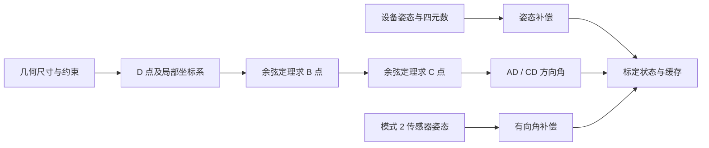

# 挖机标定与坐标算法

本说明对应 `native/recovered/` 中已通过对照的源码。符号名、字段顺序来自原始库导出和 JNA 接口；Ghidra 伪代码只用于辅助定位，最终以 ARM64 指令与测试输出为依据。

## 模式 1.0

输入结构为四元数向量部分 `world_from_device=(qx,qy,qz)` 及 `GL,GR,LR,HG`。

1. 按原库规则补四元数标量：`w=sqrt(1-qx²-qy²-qz²)`；若平方余量不大于零，则原库退回单位四元数。这是对原行为的复现，不是建议新增的输入校验策略。
2. 检查长度范围和三角形约束。
3. 沿基线投影距离：`along=(GR²+LR²-GL²)/(2 LR)`。
4. 横向距离：`lateral=sqrt(GR²-along²)`。
5. 两个几何点写为 `(lateral,along-LR,HG)` 与 `(lateral,along,HG)`。
6. 原始设备四元数转为 roll/pitch 角，标定状态的 yaw 置零；生成共轭四元数缓存。

参考原 ELF：公开入口 `0x0da0`，内部标定 `0x1660`，缓存生成 `0x1778`。源码保留原有失败码和状态清零范围。

## 模式 2.0 / 3.0

参数包含 `HA,Hy,Ay,Ax,Dx,AD,BD,CD,BC` 和铲斗 `AB/TT[4]`；模式 2 还接收传感器姿态。



初始点 `A=(Ax,0,HA)`，`H=(0,0,HA)`。D 点的初始高程为 `HA-sqrt(AD²-(Ax-Dx)²)`，随后使用从 A 方向到 Z 方向的旋转，转到局部工作平面。通过余弦定理、单位方向向量及其平面法向量依次得到 B、C 点。

模式 2、3 的姿态补偿方向不同，不能把一个模式的四元数反向规则直接套到另一个模式。模式 2 还会投影设备/传感器轴，计算有向角，补偿到存储的 CD 角。源码遵循原库的单精度 yaw 提取、四元数标量非负约定以及缓存偏移。

- 模式 2 原 ELF：入口 `0x0e20`，内部 `0x1b80`，传感器角 `0x3078`。
- 模式 3 原 ELF：入口 `0x108c`，内部 `0x3844`。
- 测试比较完整内部状态的 312 字节，而不是仅比较返回码；整数与未用区域按字节检查，浮点字段按容差检查。

两个模式各有 500 个随机/约束用例，其中成功标定分别为 113、127 次。测试不证明全部边界、设备噪声或真实机械安装条件下都等价。

## 铲斗数据格式

`Tool={AB,TT[4]}`，每个点为三个 double，总计 104 字节。生成点时使用三角形约束、余弦定理和宽度两侧偏移。二进制铲斗格式为 56 字节：

- 第 0 字节：类型 `0x81`。
- 第 1/2 字节：小端 CRC16。
- 第 3 字节：版本 `1`。
- 后续 13 个 float：AB 与 4 个三维点。
- CRC 为多项式 `0x1021` 的 CRC16，初值为类型字节，覆盖第 3 字节起的明文。
- 第 3 字节起逐字节异或，状态递推为 `state=(state*0x1c55)%0x6a93`，初值为类型值加 CRC 值。

它与“整个标定状态”的序列化是两个不同接口。后者尚未源码还原，混合版仍转发原库。

## 四参数

参数为 `(dx,dy,r,k)`，`r` 使用弧度，`k` 是绝对比例，单位变换为 `k=1`：

```
X = dx + k (cos(r) x - sin(r) y)
Y = dy + k (sin(r) x + cos(r) y)
```

逆变换先减平移，再施加反向旋转并除以比例。原函数只写 X/Y，保留输出对象的 Z；源码也这样处理。

四参数拟合先中心化对应点，以二维相似变换最小二乘求旋转和比例，再求平移。退化源点的分母阈值为 `1e-12`。残差的 Z 分量遵循原始实现对临时点清零的行为，不能擅自改成另一种业务意义。

## 七参数

参数为平移 `(dx,dy,dz)`、小旋转 `(rx,ry,rz)`、绝对比例 `k`。原库使用线性化旋转，**不是**完整 Euler 旋转：

```
[X]   [dx]       [ 1  -rz   ry ] [x]
[Y] = [dy] + k * [ rz  1   -rx ] [y]
[Z]   [dz]       [-ry  rx    1 ] [z]
```

逆变换求上述矩阵的实际逆，而非简单把三个旋转量取负。七参数拟合仍只有反编译伪代码，没有纳入已还原的 C 模块。

## 已还原与原库依赖

混合 APK 使用 12 个已还原挖机接口；未还原的优化标定与微调接口均明确转发。坐标 C 模块目前作为独立可编译模块交付，未自动替换原应用 JNI。硬件运行、动态加载与真实工程精度尚未验证。
